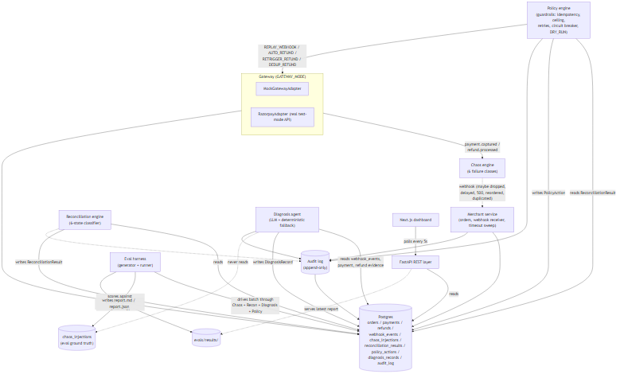

# Limbo

**An AI reconciliation agent for PayPal merchants.** It finds payments PayPal captured but the merchant never saw, checks the facts with PayPal's own APIs, and recovers the money before the buyer opens a dispute.

Built for the [PayPal AI Hackathon](https://paypalaihackathon.devpost.com/) (see [What's new for the hackathon](#whats-new-for-the-paypal-ai-hackathon-after-1-oct-2026)). MIT licensed.

**Live:** [limbo-ochre.vercel.app](https://limbo-ochre.vercel.app) (dashboard) · [limbo-ochre.vercel.app/demo](https://limbo-ochre.vercel.app/demo) (watch one PayPal sandbox payment go into limbo and recover, live). The API runs on Render's free tier, so the first click after a quiet spell can take ~40 s while it wakes.

### Try it as a judge (2 minutes)

1. Open **/demo** and pick a scenario.
2. **Make Test Payment** creates a real PayPal sandbox order. Approve it in the PayPal tab with the sandbox buyer account below, then come back and click **I've completed the payment**.
3. Limbo captures the payment through Orders v2, then drops the merchant's webhook on purpose. You then watch, streamed live from the audit log:
   reconciliation detects the mismatch → the **Gemini investigator calls PayPal's APIs (read-only)** to confirm the capture and check for disputes → it writes a diagnosis and a draft message to the buyer → the deterministic **policy engine** decides → a **real PayPal sandbox refund** is issued (or the order is completed by webhook replay).
4. No PayPal login handy? **Run Failure Scenario** runs the same pipeline on a scripted mock payment.

Sandbox buyer account for judging: see the Devpost submission's "Testing instructions" field (sandbox-only credentials, no real money).

## The problem

A customer pays on a merchant app. The payment gateway marks the payment successful and debits the money. But the success webhook to the merchant is lost, delayed, or fails mid-processing. The merchant's system shows "payment gateway failure," cancels the order, and — because its own records say the payment failed — never triggers a refund.

The money sits in limbo: successful on the gateway, non-existent on the merchant. The gateway thinks it was paid. The merchant thinks it failed. The customer thinks they were charged for nothing. Today, resolving this takes weeks of manual customer escalation, if it gets resolved at all.

This is not a hypothetical. It's a real failure mode of asynchronous payment systems, and it happens at scale on every payment platform that relies on webhooks.

## What Limbo does

Limbo is an agentic system that continuously reconciles gateway payment records against merchant order records, classifies every mismatch into one of six states, diagnoses the root cause from observable evidence, and executes a bounded recovery action — complete the order, replay the webhook, auto-refund, or escalate to a human — with hard guardrails: idempotency, amount ceilings, retry limits, a circuit breaker, and an immutable audit trail.

It reports measured money recovered across a synthetic 500-transaction batch, and has been verified end to end against one real Razorpay test-mode payment — real order, real webhook-drop simulation, real reconciliation, real refund executed via the live API.

## What's new for the PayPal AI Hackathon (after 1 Oct 2026)

Limbo existed before the hackathon as a Razorpay/mock-gateway prototype (last update 4 Sep 2026). Everything below was built during the submission period; `git log --since=2026-10-01` shows it.

| Area | What was added |
|---|---|
| PayPal gateway | `backend/app/gateway/paypal_adapter.py`: OAuth2 client credentials, **Orders v2** create + capture, **Payments v2** capture lookup and refunds (with `PayPal-Request-Id` idempotency), refund status re-checks, amounts in USD minor units. `PAYPAL_BASE_URL` is locked to the sandbox; a live URL is rejected at startup. |
| PayPal webhooks | `POST /webhooks/paypal` (`backend/app/api/paypal_webhooks.py`): every event is checked with **verify-webhook-signature**, de-duplicated on PayPal's event id, and mapped onto Limbo's ledger. Handles `PAYMENT.CAPTURE.COMPLETED`, `PAYMENT.CAPTURE.REFUNDED`, `PAYMENT.CAPTURE.REVERSED`, `CUSTOMER.DISPUTE.CREATED`. |
| AI investigator | `backend/app/diagnosis/llm.py` + `paypal_tools.py`: Gemini (`gemini-3.5-flash-lite` on the free tier of the Gemini API, overridable with `GEMINI_MODEL`) runs a bounded tool loop with three **read-only** PayPal tools (`get_capture`, `get_refund`, `list_disputes`), then returns a structured diagnosis, recommended action and a draft buyer message. Each tool call is written to the audit trail and streamed to `/demo`. |
| Dispute prevention | A `CUSTOMER.DISPUTE.CREATED` on a tracked payment is escalated to a human at once, with a Gemini-drafted dispute response built only from the audit trail (`backend/app/diagnosis/dispute.py`). |
| Live demo | `/demo` now runs on real PayPal sandbox orders: approve → capture → dropped webhook → agent → policy → real refund. |
| Dashboard | Limbo queue rebuilt on **AG Grid** (sort, filter, quick search, pagination), currency-aware amounts, gateway/AI mode badges. |
| Deploy | `render.yaml` Blueprint now deploys both the API and the dashboard on **Render** in PayPal mode. |
| Tests | `backend/tests/test_paypal_adapter.py`, `backend/tests/test_paypal_agent.py`: fake PayPal sandbox + fake Gemini, covering the tool scope guard, the investigator loop, the full PayPal demo lifecycle and webhook dispute escalation. 74 tests pass. |

### A real PayPal sandbox run (11 Nov 2026)

One full lifecycle on the hosted deployment, against the real PayPal sandbox:

| Step | Result |
|---|---|
| Buyer approves a PayPal order | order `359382719Y0630611`, 10.00 USD (Limbo order `demo_1ddb4f9798ab`) |
| Limbo captures it | capture `2L702242CT559240M`, `COMPLETED` |
| Webhook dropped on purpose | order cancelled, payment still captured |
| Reconciliation | classified `LIMBO_PAID_CANCELLED`, diagnosed `WEBHOOK_DROPPED` |
| Policy engine | `AUTO_REFUND`, executed |
| PayPal refund | refund `8EB89938K82336056`, `COMPLETED` |

In this run the diagnosis came from the deterministic fallback, not the Gemini agent: the free-tier Gemini call did not succeed, and the pipeline carried on without it, which is the designed behaviour.

A second run the same day (Limbo order `demo_e32535bf8430`, capture `0LF514929S883331F`, 10.00 USD) shows the agent at work. Gemini called PayPal itself before concluding, and both lookups landed in the audit trail:

| Audit event | What PayPal returned |
|---|---|
| `investigation / paypal.get_capture` | capture `COMPLETED`, 10.00 USD, `final_capture: true` |
| `investigation / paypal.list_disputes` | no disputes |
| `investigation / gemini.unavailable` | the concluding call got a 503 from the free tier ("high demand"), so the deterministic classifier finished the diagnosis |
| `decision` / `outcome` | `AUTO_REFUND`, `EXECUTED` |

The failure is recorded as an audit event with its reason, so a fallback is never silent.

### Why the AI can't move money

The agent investigates and explains; it never acts. Its PayPal access goes through `PayPalAdapter.get`, which refuses anything but HTTP GET, and each tool only accepts the capture id under investigation (or refund ids PayPal itself links to it), so text inside an API response can't steer it toward other data. The concluding call is a separate request that offers no tools at all. What actually happens to the money is decided by the deterministic `PolicyEngine`: idempotency keys, an amount ceiling, retry limits, a circuit breaker and `DRY_RUN`. Without a `GEMINI_API_KEY`, diagnosis falls back to a deterministic classifier and recovery still works.

### Run PayPal mode locally

1. In the [PayPal developer dashboard](https://developer.paypal.com/dashboard/applications/sandbox), create a sandbox REST app and note its client id and secret. Sandbox test accounts (a business and a personal buyer) are under **Testing Tools → Sandbox Accounts**.
2. In `backend/.env`: `GATEWAY_MODE=paypal`, `PAYPAL_CLIENT_ID`, `PAYPAL_CLIENT_SECRET`, `PAYPAL_CURRENCY=USD`, `DEMO_ORDER_AMOUNT_PAISE=1000`, `DEMO_MAX_AMOUNT_PAISE=1000` (minor units, so $10.00), and optionally `GEMINI_API_KEY` (free from Google AI Studio).
3. `make up && make api` and `make dashboard`, then open `http://localhost:3000/demo`.
4. Optional webhooks: expose the API (e.g. a tunnel), add a webhook in the sandbox app pointing at `https://<host>/webhooks/paypal` for the four events above, and set `PAYPAL_WEBHOOK_ID`. The dashboard's Webhooks Simulator works for testing.

Script-only path, without the dashboard: `cd backend && python -m scripts.paypal_manual_checkout`, approve the printed link, then `python -m scripts.verify_paypal <order_id> <paypal_order_id>`.

### Built with

PayPal Orders v2, Payments v2 (captures, refunds), Disputes API (read), Webhooks + verify-webhook-signature, all on the PayPal sandbox · Gemini API (`gemini-3.5-flash-lite`, function calling + structured JSON output) · FastAPI, SQLAlchemy, Postgres · Next.js 14, AG Grid Community, Recharts · Render (API + dashboard), Supabase Postgres.

## Architecture



Full diagrams, with narration, in `docs/`:

- [`docs/architecture.md`](docs/architecture.md) — components and data flow
- [`docs/state-machine.md`](docs/state-machine.md) — the six-state classification and guardrail-forced escalations
- [`docs/recovery-flow.md`](docs/recovery-flow.md) — one full `LIMBO_PAID_CANCELLED` lifecycle, sequence diagram
- [`docs/failure-injection-map.md`](docs/failure-injection-map.md) — where each of the six chaos classes strikes and what footprint it leaves
- [`docs/decisions.md`](docs/decisions.md) — ADR-style log of every non-obvious design decision, including real bugs found while building and how they were fixed

**Where the LLM is used, and where it deliberately isn't:** deterministic code owns reconciliation diffing, guardrail enforcement, idempotency, and metrics. The LLM (Gemini) is used only for root-cause narration and ambiguous-case triage — with a deterministic fallback that runs identically offline, and a hard rule that the LLM path can never route directly to a money-moving action. See `docs/decisions.md` ADR-017.

**The public demo** (`/demo` on the live site, `app/demo/` in the backend) drives the same `ReconciliationEngine`, `DiagnosisEngine`, and `PolicyEngine` as the general pipeline, on one order at a time, and streams its real audit log rows to the browser over server-sent events as they're written — nothing shown is fabricated or optimistic. Each demo order is isolated behind an unguessable per-order token, capped at a fixed small amount regardless of the deployment's general `MAX_AUTO_AMOUNT_PAISE`, and rate-limited per IP, so it's safe to leave open to the public.

## Quickstart

Requires Docker and Python 3.11+. A `GEMINI_API_KEY` is optional — every LLM call site degrades to a deterministic fallback without one.

```bash
cp .env.example .env
make setup
make up          # starts Postgres
make demo        # runs the 500-transaction eval batch in mock mode
```

Then, optionally:

```bash
make api         # FastAPI backend on :8000
make dashboard   # Next.js dashboard on :3000
```

Run the full verification suite (unit tests + all seven phase scripts):

```bash
make verify-all
```

Regenerate the eval report on demand:

```bash
make eval        # writes evals/results/report.md and report.json
```

Switch to real Razorpay test-mode calls (order creation, refunds, webhook signature verification are all real API calls; see `docs/decisions.md` ADR-018 for why payment *creation* still requires one manual checkout):

```bash
# in .env: GATEWAY_MODE=razorpay, RAZORPAY_KEY_ID, RAZORPAY_KEY_SECRET
make razorpay-checkout   # prints a real test-mode payment link
# pay it with a Razorpay test card, then:
cd backend && python -m scripts.verify_phase6 <order_id> <payment_id>
```

## Deployment

The live site runs on three free-tier services: Vercel (dashboard), Render (FastAPI app, with the reconciliation loop embedded since Render's free plan has no separate Background Worker), and Supabase (Postgres). Full architecture, env vars, and the free-tier caveats that follow from them (cold start, database auto-pause) are in [`docs/deployment.md`](docs/deployment.md); the Render service itself is defined in [`render.yaml`](render.yaml).

## Results

Latest 500-transaction eval batch (mock mode, `make eval`):

| Metric | Result |
|---|---|
| Detection accuracy (recon vs. ground truth) | 100.0% |
| Diagnosis accuracy (vs. chaos ground truth) | 100.0% |
| Loss prevented (refunds executed) | ₹28,366.00 |
| Revenue recovered (webhook replay) | ₹0.00 — see note below |
| False-intervention rate | 0.00% (circuit breaker threshold: 2%) |
| MTTR baseline (documented real-world manual escalation) | 21 days |
| MTTR, this run | same reconciliation cycle (minutes, mock mode) |
| Escalated exceptions | 0 |

Full breakdown, including per-state precision/recall: [`evals/results/report.md`](evals/results/report.md).

**On the ₹0 revenue-recovered figure:** this batch's timeline always reconciles after the fulfillable window has already elapsed, so `LIMBO_PAID_CANCELLED` cases in this particular run resolve via `AUTO_REFUND`, not `REPLAY_WEBHOOK`. `REPLAY_WEBHOOK` is real and verified separately — Phase 4's dedicated within-window scenario proves it end to end. This is reported honestly (`docs/decisions.md` ADR-021) rather than engineered to populate both buckets artificially. Honest metrics over massaged ones was a standing rule for this build.

One real Razorpay test-mode recovery lifecycle was also completed: a real payment (`pay_TSrHOuMZY7szwc`), a simulated webhook drop, correct detection and `AUTO_REFUND` decision, and a real refund (`rfnd_TTAg77RyCFBQrL`) executed and confirmed against the live API. See ADR-018/019/020 for the two real API constraints and one real bug that surfaced along the way.

## Project layout

```
limbo/
├── backend/           FastAPI + SQLAlchemy + Postgres. app/{merchant,gateway,chaos,recon,diagnosis,policy,audit,api}/
├── dashboard/          Next.js 14 single-page dashboard
├── evals/              generator.py, runner.py, scenarios/, results/
├── docs/                architecture, state machine, recovery flow, failure map, decisions
└── docker-compose.yml
```

## Guardrails

Every recovery action is idempotent (keyed on `{order_id}:{action_type}`), capped at `MAX_AUTO_AMOUNT_PAISE` (default ₹5,000) above which it escalates to a human, retried at most `MAX_RETRY_ATTEMPTS` times with exponential cooldown before escalating, and gated by a circuit breaker that halts all auto-actions if the false-intervention rate exceeds `CIRCUIT_BREAKER_FALSE_INTERVENTION_RATE` (default 2%). `DRY_RUN=true` is the default in `.env.example` — every action is proposed and audit-logged but not executed until explicitly turned off. Every detection, diagnosis, decision, action, and outcome is written append-only to the audit log.
