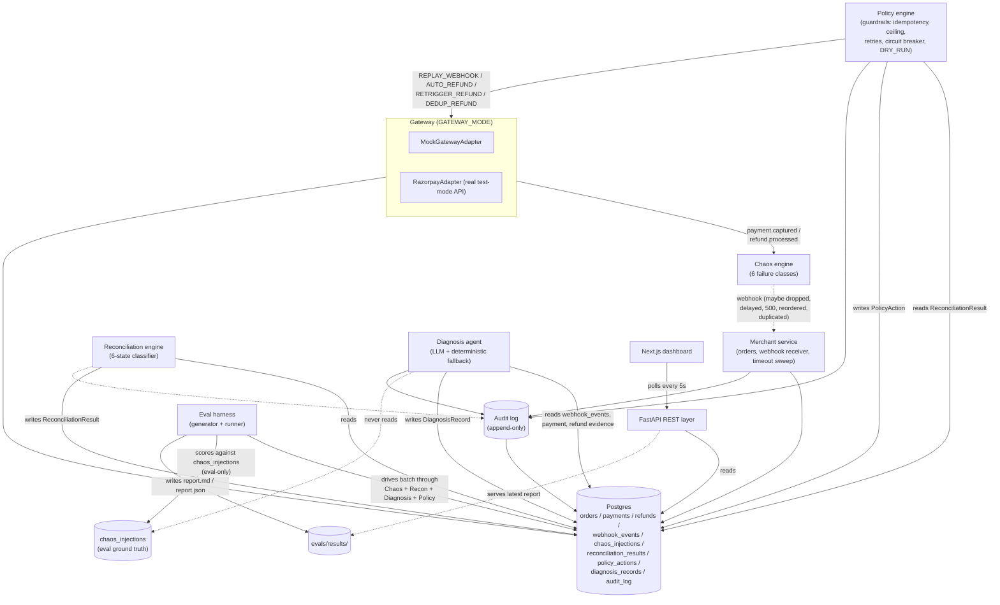

# System Architecture

Components and data flow for Limbo's reconciliation and recovery pipeline. Solid arrows are synchronous calls; dashed arrows are webhook deliveries (real or simulated).

Key boundaries:

- **Gateway is swappable** behind one interface (`GatewayAdapter`) — mock and real Razorpay implementations, same call sites. See `docs/decisions.md` ADR-004, ADR-018.
- **Diagnosis never reads chaos ground truth** — only the eval harness does, and only to score results after the fact, never to inform them. See ADR-007, ADR-017.
- **Every stage writes to the audit log** — detection, diagnosis, decision, action, outcome — append-only, never updated or deleted.
