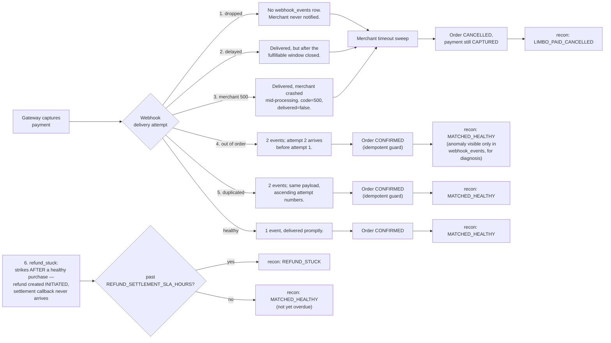

# Failure Injection Map

Where each of the six chaos classes strikes in the payment flow, and the footprint each one leaves for reconciliation and diagnosis to find.

Only the first five classes touch webhook delivery for the *capture* event; `refund_stuck` is independent — it strikes the refund settlement callback on an otherwise-healthy transaction. See `docs/decisions.md` ADR-010 for why chaos never directly cancels an order (the merchant's own timeout sweep does), and ADR-013 for why `refund_stuck` needs its own, much longer, SLA window before it is classified as actually stuck.
