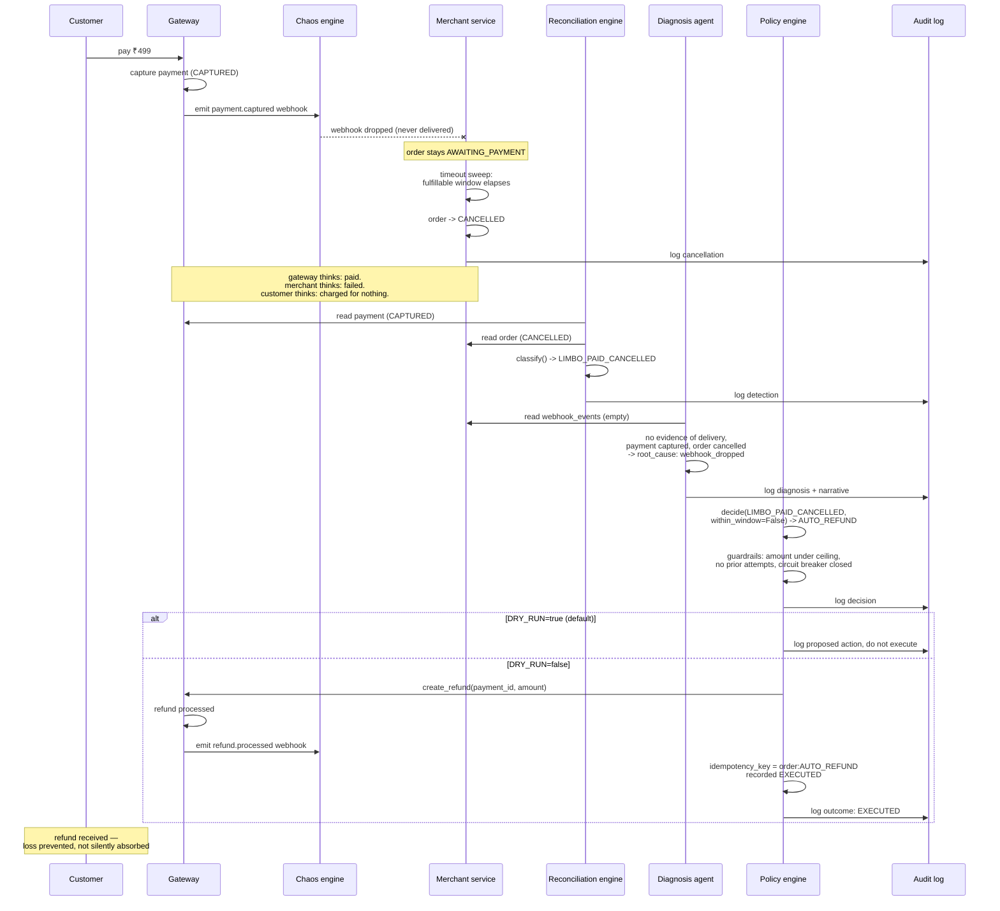

# Recovery Flow — One Full LIMBO_PAID_CANCELLED Lifecycle

The flagship case: payment succeeds on the gateway, the webhook that would tell the merchant is lost, the merchant cancels the order believing it failed, and Limbo detects and recovers the loss.

A re-run of the agent over the same transaction is safe: `policy.act()` checks for a prior `EXECUTED` attempt under the same idempotency key (`{order_id}:{action_type}`) before doing anything, and returns `SKIPPED_IDEMPOTENT` without touching the gateway again.
