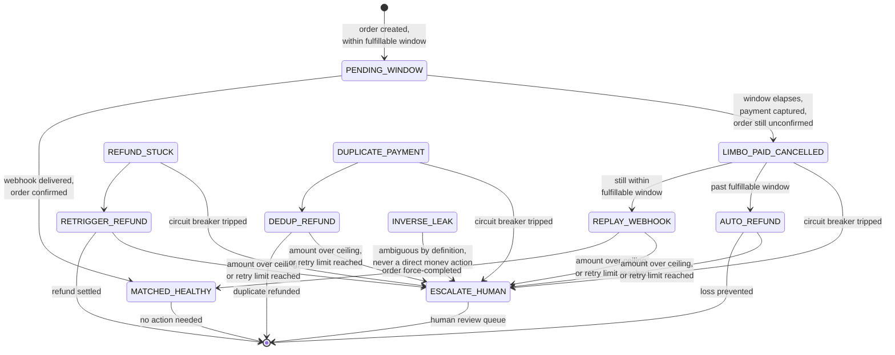

# Transaction State Machine

The six terminal classifications produced by `recon/classifier.py`, and the guardrail-forced transitions to `ESCALATE_HUMAN` applied by the policy engine on top of them.

Notes:

- `PENDING_WINDOW` and `MATCHED_HEALTHY` need no recovery action — the policy engine's `decide()` returns `None` for both.
- The guardrail-forced `ESCALATE_HUMAN` transitions (amount ceiling, retry limit, circuit breaker) apply uniformly across every action-producing state — drawn once here rather than duplicated per state, since the logic in `policy/selector.py` and `policy/engine.py` is identical regardless of which base action triggered it.
- `DUPLICATE_PAYMENT` and `INVERSE_LEAK` are implemented in the classifier and selector but not produced by the current chaos engine — see `docs/decisions.md` for what is and isn't exercised by the eval harness.
